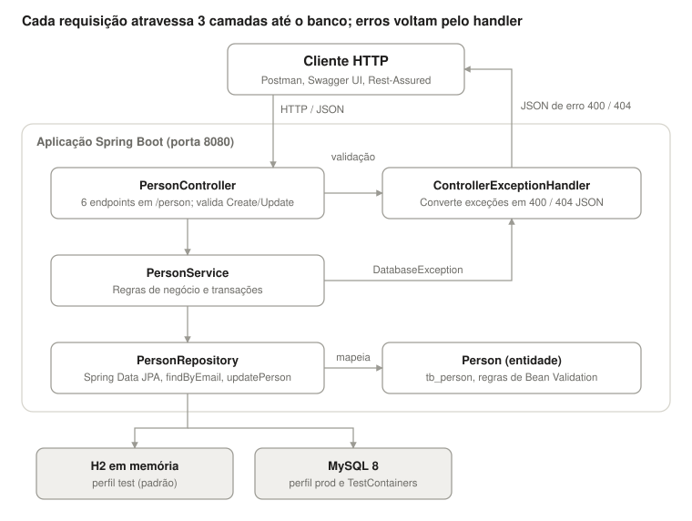

# Documentação da arquitetura

> Entrega 2 · 09/11/2026 · Projeto A3 — Gestão da Qualidade de Software

O rest-spring-test é uma API REST monolítica em Spring Boot, organizada em 4 camadas (Controller → Service → Repository → Banco), que expõe 6 endpoints CRUD sobre uma única entidade, `Person`. O código de produção tem 9 classes e 470 linhas; o código de teste existente tem 8 classes, 1.409 linhas e 40 testes.

## 1. Visão geral

O controller valida a entrada e delega ao service; o service aplica as regras e usa o repository. Toda exceção de validação ou de negócio é convertida em JSON pelo handler, e o banco muda só por perfil.

## 2. Stack tecnológica

| Item | Tecnologia | Versão |
| --- | --- | --- |
| Linguagem | Java | 21 |
| Framework | Spring Boot (Web, Data JPA, Validation) | 3.3.3 |
| Build | Maven (com wrapper `mvnw`) | — |
| Persistência | Spring Data JPA / Hibernate | gerenciada pelo Spring Boot |
| Banco de dados | H2 em memória (perfil `test`) e MySQL 8 (perfil `prod`) | — |
| Documentação da API | springdoc-openapi (Swagger UI) | 2.5.0 |
| Boilerplate | Lombok, Bean Validation (Jakarta) | — |
| Testes | JUnit 5, Mockito, Rest-Assured, TestContainers (MySQL) | — |
| Relatórios | JaCoCo (cobertura), Maven Surefire Report | 0.8.12 / 2.22.0 |

## 3. Componentes

| Componente | Camada | Responsabilidade |
| --- | --- | --- |
| `PersonController` | Apresentação | Recebe as requisições em `/person`, aplica a validação por grupo (`Create` / `Update`) e devolve o status HTTP |
| `ControllerExceptionHandler` | Apresentação | `@ControllerAdvice` que converte exceções em respostas JSON padronizadas (`StandartError`, `ValidationError`) |
| `PersonService` | Negócio | Regras de negócio e transações: busca, unicidade de e-mail no cadastro, existência antes de atualizar e excluir |
| `DatabaseException` | Negócio | Única exceção de negócio; usada tanto para "não encontrado" quanto para "e-mail já cadastrado" |
| `PersonRepository` | Persistência | `JpaRepository` + `findByEmail` + `updatePerson` (UPDATE em SQL nativo) |
| `Person` | Modelo | Entidade JPA mapeada para `tb_person`, com as regras de validação |
| `StartUp` | Infraestrutura | Classe principal e metadados OpenAPI (declara licença MIT) |

## 4. Modelo de dados

Tabela `tb_person`, criada pelo Hibernate (`create-drop` no H2, `update` no MySQL). Não há constraints de banco além da chave primária: unicidade de e-mail e obrigatoriedade existem só na aplicação.

| Campo | Coluna | Tipo / tamanho | Regras na aplicação |
| --- | --- | --- | --- |
| `id` | `id` | BIGINT, auto-incremento | Obrigatório só no PUT (`@NotNull`, grupo `Update`) |
| `firstName` | `first_name` | VARCHAR(20) | `@NotBlank` (Create, Update) |
| `lastName` | `last_name` | VARCHAR(20) | `@NotBlank` (Create, Update) |
| `address` | `address` | VARCHAR(100) | `@NotBlank` (Create, Update) |
| `gender` | `gender` | VARCHAR(10) | `@NotBlank` (Create, Update); texto livre |
| `email` | `email` | VARCHAR(50) | `@NotBlank` (Create, Update) e `@Email` sem grupo; único no cadastro (checado no Service) |

## 5. Endpoints

| Método | Rota | Sucesso | Erros previstos |
| --- | --- | --- | --- |
| GET | `/person?page&size&sort` | 200 + página (padrão 10 itens, ordem por `id` ASC) | — |
| GET | `/person/id/{id}` | 200 + pessoa | 404 não encontrado; 400 id não numérico |
| GET | `/person/email/{email}` | 200 + pessoa | 404 não encontrado |
| POST | `/person` | 201 + pessoa criada | 400 validação; 400 e-mail já cadastrado |
| PUT | `/person` | 200 + texto "Profile updated successfully" | 400 validação; 404 id inexistente |
| DELETE | `/person/id/{id}` | 204 sem corpo | 404 não encontrado; 400 id não numérico |

## 6. Tratamento de erros

| Exceção | Origem | Status | Corpo |
| --- | --- | --- | --- |
| `DatabaseException` com "Email already registered" na mensagem | `save` | 400 | `StandartError` |
| `DatabaseException` (demais mensagens) | `findById`, `findByEmail`, `update`, `deleteById` | 404 | `StandartError` |
| `MethodArgumentNotValidException` | Bean Validation no corpo | 400 | `ValidationError` (lista de mensagens) |
| `ConstraintViolationException` | Validação de parâmetros | 400 | `ValidationError` |
| `MethodArgumentTypeMismatchException` | Path variable com tipo errado | 400 | `ValidationError` |
| `NoHandlerFoundException` | Rota inexistente | 404 | `ValidationError` |
| Qualquer outra (ex.: violação de tamanho de coluna) | Banco | 500 (padrão do Spring) | Sem tratamento |

O status entre 400 e 404 é decidido comparando o texto da mensagem da exceção, e não o tipo do erro.

## 7. Perfis de ambiente

| Perfil | Banco | Uso | Observação |
| --- | --- | --- | --- |
| `test` (ativo por padrão) | H2 em memória | Execução local e demonstração | Dados apagados a cada reinício |
| `prod` | MySQL `localhost:3306/db_test` | Produção | Usuário e senha `root/root` fixos no arquivo |
| Testes de integração | MySQL via TestContainers, porta 8888 | `PersonControllerIntegrationTest`, `SwaggerIntegrationTest` | Exige Docker ativo |

## 8. Testes existentes no repositório

| Classe | Nível | Ferramentas | Testes |
| --- | --- | --- | --- |
| `PersonServiceTest` | Unitário | JUnit 5 + Mockito | 12 |
| `PersonControllerTest` | Unitário de camada web | MockMvc + Mockito | 11 |
| `PersonRepositoryTest` | Integração com banco (H2) | `@DataJpaTest` | 9 |
| `PersonControllerIntegrationTest` | Integração / API | Rest-Assured + TestContainers | 6 |
| `SwaggerIntegrationTest` | Integração | Rest-Assured + TestContainers | 1 |
| `StartUpTests` | Smoke | Spring Boot Test | 1 |
| **Total** | | | **40** |

Os testes existentes cobrem os caminhos felizes e os "não encontrado", mas nenhum exercita validação de campos, formato de e-mail ou limites de tamanho. Esses são os focos dos testes novos da equipe (ver [Plano de testes](../plano-de-testes/plano-de-testes.md)).
