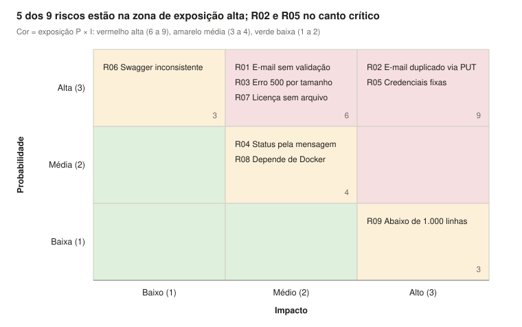

# Análise de riscos

> Entrega 2 · 09/11/2026 · Projeto A3 — Gestão da Qualidade de Software

Foram identificados 9 riscos; 5 têm prioridade Alta e concentram os testes, com destaque para R02 (e-mail duplicado via PUT) e R05 (credenciais fixas), ambos com exposição máxima. As probabilidades vieram da leitura do código; os riscos de produto viram defeitos confirmados ou descartados na execução da Entrega 3.

Escala: probabilidade e impacto de 1 (Baixo) a 3 (Alto). Exposição = P × I. Prioridade Alta para exposição ≥ 6, Média para 3 a 4, Baixa para ≤ 2.

## 1. Matriz probabilidade × impacto

A linha de probabilidade Alta concentra 6 riscos porque quase todos são fatos visíveis no código; o que ainda falta é confirmar o efeito executando os testes.

## 2. Registro de riscos

| ID | Risco | Evidência no código | P | I | Exp. | Prioridade | Resposta / testes |
| --- | --- | --- | --- | --- | --- | --- | --- |
| R02 | E-mail duplicado pela atualização, quebrando buscas por e-mail | `update` não verifica e-mail e a coluna não tem UNIQUE; com dois registros iguais, `findByEmail` (retorno `Optional`) tende a falhar com erro 500 | 3 | 3 | 9 | Alta | Mitigar: testar CT18, CT07, CT12 após duplicar; propor UNIQUE + checagem no `update` |
| R05 | Credenciais do banco expostas | `application-prod.yml` com usuário e senha `root/root` versionados | 3 | 3 | 9 | Alta | Mitigar: CT33, SonarQube; propor variáveis de ambiente |
| R01 | E-mail com formato inválido aceito | `@Email` sem `groups`, enquanto o controller valida só os grupos `Create`/`Update` | 3 | 2 | 6 | Alta | Mitigar: CT11, CT29; propor incluir os grupos |
| R03 | Erro 500 em campos acima do tamanho | Colunas limitadas (20, 100, 10, 50) sem `@Size`; exceção de banco não tratada no handler | 3 | 2 | 6 | Alta | Mitigar: CT13, CT14; propor `@Size` e handler para erro de integridade |
| R07 | Licença não identificável no repositório | Sem arquivo LICENSE; o selo do README aponta para outro repositório; só a anotação OpenAPI declara MIT | 3 | 2 | 6 | Alta | Aceitar com registro: citar a anotação MIT no relatório e confirmar com o professor |
| R04 | Status HTTP errado após mudança de mensagem | Handler decide 400 ou 404 com `contains("Email already registered")` | 2 | 2 | 4 | Média | Mitigar: CT27; propor exceções específicas |
| R08 | Cobertura medida incompleta | Testes de integração dependem de Docker (TestContainers) | 2 | 2 | 4 | Média | Mitigar: garantir Docker em uma máquina; registrar cobertura com e sem integração |
| R06 | Documentação da API engana o consumidor | Exemplo do POST no Swagger sem `email` (obrigatório); PUT devolve texto declarando JSON; descrição do GET por id fala em e-mail | 3 | 1 | 3 | Média | Mitigar: CT23; registrar como defeitos de severidade Baixa |
| R09 | Sistema abaixo do tamanho mínimo da A3 | 470 linhas de produção contra mínimo de 1.000 no enunciado; o sistema consta da lista sugerida pelo professor | 1 | 3 | 3 | Média | Aceitar: registrar no relatório; somando os testes o projeto passa de 1.800 linhas |

R01 a R06 são riscos de produto; R07 a R09 são riscos de projeto da A3.

## 3. Prioridades de teste

1. **Alta:** CT18, CT11, CT13, CT14, CT29, CT33. Executar primeiro e registrar defeitos.
2. **Média:** CT27, CT23, CT34. Executar em seguida.
3. **Base:** demais casos (caminhos felizes já cobertos pela suíte original), executados como regressão.
